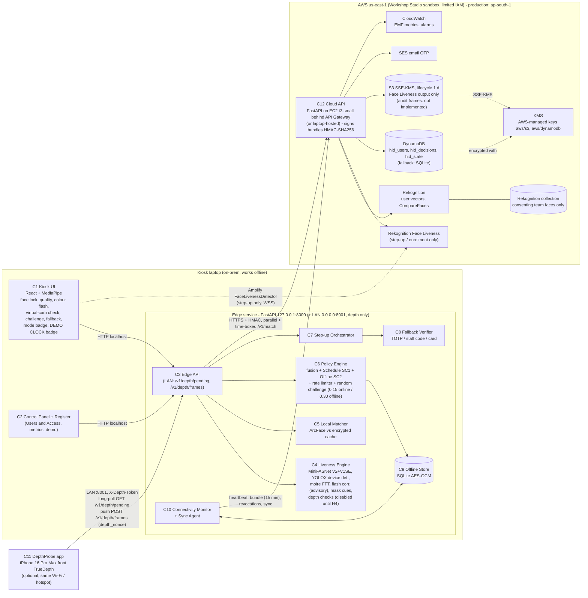
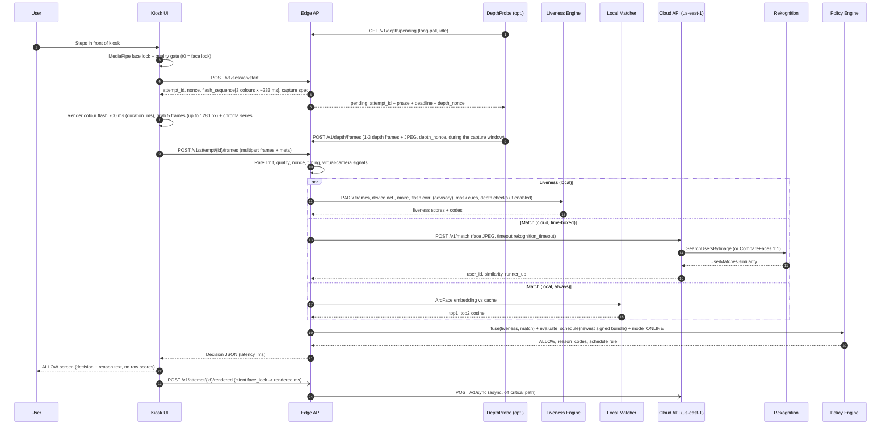
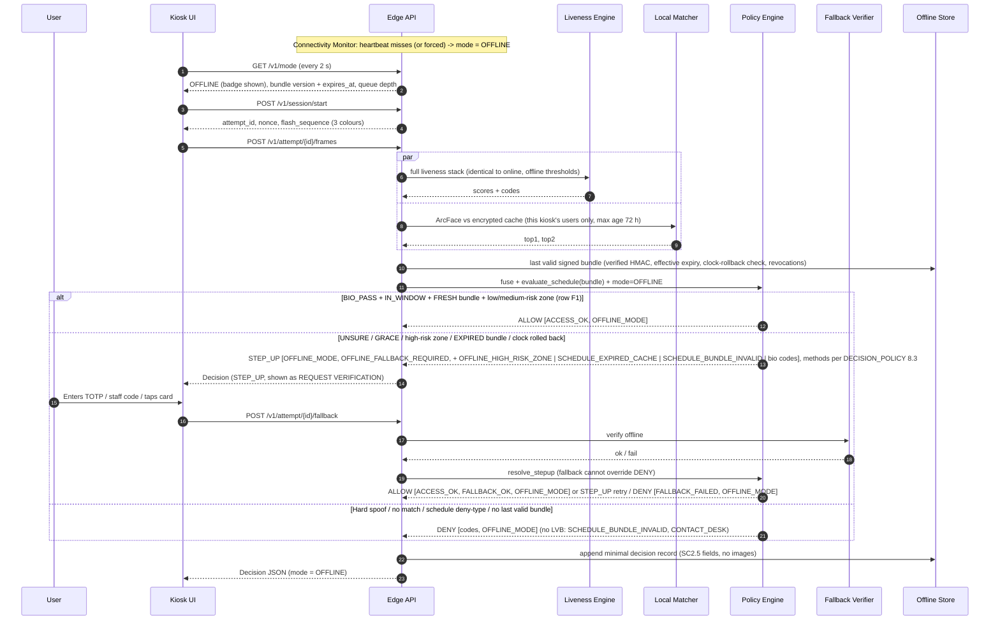
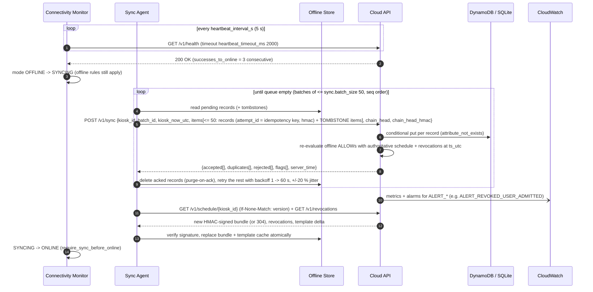

# ARCHITECTURE.md — HID Entry Kiosk: Liveness + Face Auth + Schedule + Offline

Consistent with `CLAUDE.md` §3 (decided architecture) and the lead decisions D1–D18 of 14 Nov 2026.
Requirements: `docs/PROBLEM.md`. Decision rules and thresholds: `docs/DECISION_POLICY.md` +
`config/thresholds.yaml` (**every number below that is a threshold is quoted from that YAML; if they
differ, the YAML wins**). Endpoint contracts: `docs/API.md` v1.4 (+ `docs/contracts/admin_access.examples.json`). SC1/SC2 rationale:
`docs/SURPRISE_CHALLENGES.md`. Test vectors: `docs/POLICY_TEST_CASES.md`.

Depth comes from our own free SwiftUI app **DepthProbe** (`depth/ios/`) on the iPhone 16 Pro Max, which
pushes 1–3 synchronised TrueDepth depth frames (+1 JPEG) per attempt to the edge; Python runs the
D0–D4/M1–M3 checks (`depth/checks.py`). Record3D (paid) is not used and there is no separate depth
bridge process. Setup: `docs/IPHONE_SETUP.md`.

**Principle: local-first, cloud-enhanced.** The Edge service on the kiosk laptop *always* produces the
decision. When online it additionally (a) runs a parallel, time-boxed Rekognition match
(fused with the local matcher per `DECISION_POLICY.md` §3.5), (b) keeps the newest cloud-issued **signed schedule bundle** and revocation feed fresh in
the background, and (c) streams decisions to the cloud. The schedule is always evaluated **on the edge**
by the same `edge.policy.schedule.evaluate_schedule` function, online and offline (D2) — there is no
per-attempt cloud schedule call. Offline (SC2) is therefore a mode of the same pipeline, not a separate
code path. **Fail-secure everywhere**: any missing, stale, or unverifiable input moves the decision
toward `STEP_UP` or `DENY`, never toward `ALLOW`.

**Execution model (D17):** Claude Code builds everything through subagents (`.claude/agents/`). The
human operator only does physical tasks: being on camera, holding attacks, plugging in / mounting the
iPhone, AWS login and credentials.

> **As-built status (2026-11-14, ~22:10 IST).** The edge (`127.0.0.1:8000` + depth-only LAN listener
> `:8001`), kiosk (`http://localhost:5173`), policy engine, offline store and sync are built and running
> locally; the cloud API is **deployed** in AWS us-east-1 (§9). Two things are deliberately *not*
> enforced yet: **colour flash is ADVISORY** (`liveness.flash.enforce: false`, §3.2): it is measured and
> reported but has no effect on the decision. **Depth is off** (`liveness.depth.enabled: false`): the H4
> calibration has not been run. **Moiré and the RGB mask ring (M2) are enforced** (`liveness.moire.enforce`,
> `liveness.mask.m2_rgb_enforce` true); genuine flash-lit frames scored 0.42–0.79 on moiré and spectacle
> frames 0.35–0.80 on M2 (dev data), so genuine users can be stepped up. **Random challenge is on**
> (`challenge.random_rate` 0.15 online / 0.30 offline; SMILE / OPEN_MOUTH + BLINK / TURN_LEFT / TURN_RIGHT).
> **Rekognition is enabled** but, from the venue, most cloud matches miss the 700 ms time box, so those
> attempts are decided OFFLINE (P7) under an ONLINE badge; the **early cloud probe** (§4.1) is in the code,
> live after an edge restart, not yet measured. The kiosk captures **5 frames over 700 ms**
> (`liveness.flash.duration_ms`, was 1000 ms) **at up to 1280 px** (`CaptureSpec.max_width_px`; at 640 px
> the inter-ocular distance was about 50 px, below `quality.min_interocular_px` 60). Every latency number
> in this file is a **dev measurement**, not an eval result; no eval run exists yet.

---

## 1. Components

| # | Component | Runs on | Tech | Responsibility | Works offline? | Owner |
|---|---|---|---|---|---|---|
| C1 | **Kiosk UI** | Kiosk browser (fullscreen Chromium) | React + Vite + TS + Tailwind; MediaPipe Face Landmarker (VIDEO mode, blendshapes + pose matrix on) | Camera capture, face lock, quality gate, colour-flash rendering (exactly 3 colours × ~233 ms), 5 frames over `liveness.flash.duration_ms` (700 ms) at up to 1280 px, virtual-camera check, challenge prompts, fallback entry (TOTP/staff/card/email OTP), decision screen (ALLOW / **REQUEST VERIFICATION** with subtitle "step-up" / DENY; API enum stays `STEP_UP`, D13) with reason text, ONLINE/OFFLINE badge (polls `GET /v1/mode` every 2 s), **DEMO CLOCK** badge when the demo clock is active, fire-and-forget early cloud probe (`POST /v1/attempt/{id}/probe` with the face-lock frame, never delays the capture), `POST /v1/attempt/{id}/rendered` beacon after the decision is painted. Code: `kiosk/src/kiosk/` (controller state machine, screens), `kiosk/src/capture/` (camera, MediaPipe, quality, flash, challenge trackers), `kiosk/src/api/` | Yes. Vite serves it on `http://localhost:5173` (IPv6 `[::1]` only, so `127.0.0.1:5173` refuses) with the MediaPipe WASM and model bundled locally | kiosk-frontend |
| C2 | **Control Panel (Admin/Metrics Dashboard) + Register page** | Same React app: `/admin` (or `#/admin`) = Control Panel, `/register` = registration page, `/operator` = operator view | React | **Users & Access** (`kiosk/src/admin/panels/UsersAccessPanel.tsx`, `AccessEditor.tsx`, `StaffCodesPanel.tsx`; client `kiosk/src/api/access.ts`) over the edge access routes of `API.md` §3.18, all `X-Admin-Token`: `GET /v1/admin/access/users` (list; read-only from the installed bundle when OFFLINE), `PUT /v1/admin/access/users/{user_id}` (create / edit role, zones, extra hours, validity; re-admit an ERASED user; Restore), `POST /v1/admin/access/users/{user_id}/revoke`, `POST /v1/admin/access/codes/rotate` (staff override codes, shown once) and `POST /v1/admin/bundle/refresh`; the edge proxies them to the cloud master (`API.md` §4.9a) and installs the re-signed bundle in the same call. **Registration = PUT-then-enrol** (R-A; `kiosk/src/operator/RegisterApp.tsx`, `kiosk/src/shared/registerFlow.ts`, and the Control Panel enrol card `EnrolPanel.tsx`): (1) ONLINE check for people not yet in the schedule; (2) `PUT /v1/admin/access/users/{user_id}` `{display, role, consent: true}`, proceed only when `bundle.applied` and `user.in_bundle` are true (else `POST /v1/admin/bundle/refresh`, up to 3 tries 1 s apart); (3) `POST /v1/enroll` (consent + DPDP notice, 5 frames at up to 1280 px; also the stand-alone `kiosk/public/enroll.html`). `GET /v1/admin/users` lists local enrolments; `DELETE /v1/enroll/{user_id}` erases (cloud `deleted` / `queued` / `not_configured` / `failed`). Also live metrics (p50/p95, decisions per reason, per attack species), demo controls (`/v1/admin/mode`, `/v1/admin/clock`, `/v1/admin/rate-limit/reset`, `/v1/admin/eval/context`), store/sync view (`/v1/admin/store`, `/v1/admin/sync`) and a live feed from `GET /v1/events`. Code: `kiosk/src/admin/` | Partly. Reads, local enrolment of people already in the installed bundle, erasure (cloud part queued) and the dashboards work offline; creating / changing / revoking access, rotating codes and registering new people need ONLINE (the cloud signs the schedule); Rekognition indexing only happens ONLINE (`cloud_state`) | kiosk-frontend |
| C3 | **Edge API** | Kiosk laptop, `127.0.0.1:8000`, plus a second listener on `0.0.0.0:EDGE_LAN_PORT` (8001) that serves **only** `GET /v1/depth/pending` and `POST /v1/depth/frames` | FastAPI, Python 3.11, Pydantic v2, uvicorn | Session/nonce issue, attempt orchestration, parallel fan-out, early cloud probe (`POST /v1/attempt/{id}/probe`, in the code, live after an edge restart), response assembly, `latency_ms`, event stream, depth endpoints for DepthProbe. Code: `edge/app.py` (routes + LAN listener), `edge/schemas.py` (HTTP models), `edge/attempts.py` (orchestration), `edge/session.py` (attempt ids, nonces, flash sequence), `edge/cloud_client.py`, `edge/enroll.py`, `edge/events.py`, `edge/metrics.py`, `edge/depth_bridge.py` | Yes | edge-ml |
| C4 | **Edge Liveness Engine** | Edge process (thread pool) | onnxruntime: MiniFASNetV2 (2.7× crop) + MiniFASNetV1SE (4.0× crop), 80×80, raw 0-255 BGR, output index 1 = real (startup self-test); RetinaFace MNv2 detector; YOLOX-Tiny COCO detector (phone/laptop/TV, Apache-2.0); numpy FFT moiré; flash-reflection correlation | Passive PAD score, device-in-frame, moiré, flash match (advisory, §3.2), mask cues, depth fusion. Signals only, no decisions. Code: `edge/ml/{detect,quality,pad,device,moire,flash,mask,onnx,registry}.py`, `edge/perception.py` | Yes | edge-ml |
| C5 | **Edge Local Matcher** | Edge process | ArcFace w600k_r50 (InsightFace buffalo_l recogniser, non-commercial weights; CoreML EP when it matches CPU) 512-d embeddings, cosine vs Fernet-encrypted template cache (`edge/data/templates.fernet`, this kiosk's entitled users only) | 1:N match top-1/top-2. It always runs and is the sole identity source offline. Online behaviour is in §4.2. Code: `edge/ml/matcher.py`, `edge/ml/templates.py` | Yes | edge-ml |
| C6 | **Edge Policy Engine** | Edge process | Pure Python, rule tables from `config/thresholds.yaml` | Three-zone fusion → biometric result; **Schedule Engine** (SC1, `evaluate_schedule` on the last valid signed bundle); **Offline rules** (SC2, `DECISION_POLICY.md` §8); random challenge (`RANDOM_CHALLENGE`, `challenge.random_rate` 0.15 online / 0.30 offline); attack-evidence rate limiter (D3); reason codes; `next_action`; any runtime exception → DENY `SYSTEM_ERROR` (never HTTP 500). Code: `edge/policy/engine.py` (pure `evaluate`/`combine`), `runtime.py` (stateful wrapper: clock, demo clock, sessions, persistence, heartbeat loop), `liveness.py`, `identity.py`, `quality.py`, `injection.py`, `schedule.py`, `ratelimit.py`, `codes.py`, `signals.py`, `thresholds.py`; facade `edge/policy_facade.py` | Yes | policy-engine |
| C7 | **Step-up Orchestrator** | Edge process | State machine per attempt | Recapture → randomised challenge (exactly one mouth/cheek deformation step + one secondary) → second factor (TOTP / card / email OTP / staff override); optional Rekognition Face Liveness; step-up retries per `DECISION_POLICY.md` §7/§9.6. Code: `edge/policy/stepup.py`, `edge/policy/challenge.py` | Yes (except email OTP, Face Liveness) | policy-engine (logic) / edge-ml (endpoints) |
| C8 | **Fallback Verifier** | Edge process | `pyotp` TOTP (RFC 6238), PBKDF2 staff codes, HMAC card-ID lookup | Verify fallback factors offline; proxy email OTP to cloud when online. TOTP always verifies against real wall time, never the demo clock. The log keeps `totp_step` (not secret) so the cloud can detect cross-kiosk TOTP replay (Y07). Code: `edge/policy/fallback.py`, `edge/offline/credentials.py` | Yes | policy-engine |
| C9 | **Offline Store** | Edge disk | SQLite + field-level AES-256-GCM (HKDF subkeys of `EDGE_DATA_KEY`), plus a signed JSON bundle file | Last valid signed bundle (`edge/data/bundle.signed.json`), minimal decision log (= sync queue), tombstones, TOTP-step / consumed-code state (§7.2). Code: `edge/offline/{store,bundle,crypto,credentials}.py` | Yes | policy-engine |
| C10 | **Connectivity Monitor + Sync Agent** | Edge background thread (state machine `edge/offline/connectivity.py`, loop in `edge/policy/runtime.py`, sync agent `edge/offline/sync.py`, request signing `edge/offline/signing.py`) | httpx (one keep-alive client) | Heartbeat `GET /v1/health` every 5 s (timeout 2000 ms), ONLINE/OFFLINE/SYNCING state, `GET /v1/mode`, forced mode (`POST /v1/admin/mode`), bundle (every 15 min) + revocation refresh (each heartbeat), queue replay | — | **policy-engine** (D7, D18) |
| C11 | **DepthProbe** *(optional, H4 go/no-go)* | iPhone 16 Pro Max (front TrueDepth), same Wi-Fi / hotspot as the laptop | SwiftUI + AVFoundation (`AVCaptureDepthDataOutput`, synchroniser), app v0.3.0 sideloaded as an unsigned IPA with Sideloadly (a v0.3.1 IPA is built; `docs/IPHONE_SETUP.md`); H4 go/no-go not run yet; edge side `edge/depth_bridge.py` + `depth/checks.py`; calibration CLI `depth/calibrate.py` | Long-polls `GET /v1/depth/pending` (returns a `depth_nonce`); captures 1–3 depth frames (+1 JPEG, intrinsics, `accuracy` absolute/relative) **during the colour-flash capture window** (and one during the mouth challenge for M1); pushes them with `POST /v1/depth/frames`, echoing the `depth_nonce` (403 on mismatch or reuse); the edge computes D0–D4, M1–M3. The app is connected. Depth stays **disabled** until the H4 calibration passes | Yes (LAN only) | depth-iphone (app, checks) / edge-ml (endpoints) |
| C12 | **Cloud API** | AWS **us-east-1** (Workshop Studio sandbox, D1); production would pin **ap-south-1 Mumbai** | FastAPI, boto3; EC2 t3.small (AL2023, warm, systemd) behind an API Gateway HTTP API (HTTPS), deployed 2026-11-14 ~10:00 UTC (later code fixes need a redeploy, `cloud/SANDBOX.md` §0). Laptop-hosted fallback on port 9000 | `/v1/match`, `/v1/schedule/{kiosk_id}`, `/v1/revocations`, `/v1/sync`, `/v1/otp/*`, `/v1/liveness/session`, `/v1/enroll`, `/v1/health`, admin routes. Code: `cloud/app/` (`main.py`, `routers/{core,admin}.py`, `services/*`, `auth.py`, `canonical.py`), deploy scripts `cloud/infra/*.sh` | — | cloud-aws |
| C13 | **Cloud Match Service** | in C12 | Amazon Rekognition user vectors (consenting team faces only, deleted at teardown) | `SearchUsersByImage` (1:N) / `CompareFaces` (1:1 claimed ID) | — | cloud-aws |
| C14 | **Cloud Schedule Service** | in C12 | DynamoDB (or SQLite fallback) + **HMAC-SHA256** bundle signing (`SCHEDULE_BUNDLE_HMAC_KEY`, D11) | Authoritative schedule (roles, users, zones, holidays, exceptions in the `config/schedule.example.json` format); signed per-kiosk bundles (`issued_at` = now, `expires_at` = now + 12 h, override-code `valid_until` = `expires_at` + 24 h); revocation feed. Production: Ed25519 (kiosk holds only the public key) | — | cloud-aws (local/demo signer: `scripts/sign_bundle.py`, source `config/schedule.demo.json`; policy-engine) |
| C15 | **Audit & Telemetry** | in C12 | DynamoDB `hid_decisions`, CloudWatch EMF; S3 SSE-KMS bucket (**1-day lifecycle**) exists, but **audit-frame upload is not implemented** | Decision ledger (idempotent), latency/decision metrics, server-side alerts (`ALERT_*`, SC2.6) incl. post-hoc revoked offline ALLOWs | — | cloud-aws |

---

## 2. Component view

Every AWS box has a degraded path (§10); none of them is needed for the edge to decide.

Trust boundaries: (1) browser ↔ Edge — localhost only, CORS restricted to the kiosk origin; the
browser is **untrusted** for security decisions (all flash/quality signals are recomputed or
cross-checked server-side). (1b) iPhone ↔ Edge — when DepthProbe is used the edge opens a second
LAN listener on `0.0.0.0:EDGE_LAN_PORT` (8001 in `.env.example`). It serves **only**
`GET /v1/depth/pending` and `POST /v1/depth/frames`, and it requires `X-Depth-Token` ==
`DEPTH_DEVICE_TOKEN`. Each pending request carries a single-use `depth_nonce` that `/frames` must echo;
a mismatch or a reuse is rejected as 403 `FORBIDDEN`. The main API stays on `127.0.0.1:8000`, and a busy
LAN port never takes the kiosk API down (`GET /v1/health` → `detail.lan_listener`). Depth is evidence
that can only add spoof or mask cues, and depth maps stay in RAM. (1c) `GET /v1/events` and
`GET /v1/metrics` are localhost-only and need no admin token; every `/v1/admin/*` and `/v1/enroll`
route needs `X-Admin-Token`. (2) Edge ↔ Cloud — TLS 1.2+, per-kiosk
API key + HMAC request signature, replay window 60 s. (3) Cloud ↔ AWS services — the event IAM role /
instance profile, least privilege.

---

## 3. Pipeline per attempt (what each stage does)

Stage order is `DECISION_POLICY.md` §2 (authoritative).

| Stage | Where | Output | Short-circuit |
|---|---|---|---|
| S0 Session | Edge `POST /v1/session/start` | `attempt_id`, single-use `nonce` (TTL 10 s), random flash sequence of **exactly 3 colours × ~233 ms** in the 700 ms window (`liveness.flash.duration_ms`; ≤ 3 changes/s, `liveness.flash.colours_max` 3), `capture` spec (5 frames, `max_width_px` 1280), `recapture_count`, `depth_requested`; queues a depth request for DepthProbe if depth is enabled | — |
| S0b Rate limit | Edge Policy | attack-evidence DENY count in the YAML window (D3) | `RATE_LIMITED` → `DENY`, `next_action` NONE + `retry_after_s` |
| S1 Face lock + quality | Kiosk (MediaPipe), re-checked on Edge | 1 face, IOD, pose, blur, luma | `QUALITY_*`, `MULTIPLE_FACES` → `STEP_UP` RECAPTURE (up to `quality.max_recaptures`); exhausted → see §3.1 |
| S2 Injection | Kiosk signals + Edge timing checks | virtual-camera label, frame-interval checks, nonce | `INJECTION_VIRTUAL_CAMERA` → `DENY` |
| S3 Liveness ‖ S4 Match | Edge, **in parallel** (`edge/attempts.py`: asyncio + thread pool) | PAD/flash/moiré/device/mask/depth scores ‖ local cosine + (online) Rekognition similarity | Hard spoof → `DENY` regardless of match. Flash is advisory (§3.2) |
| S5 Biometric fusion | Edge Policy | `BIO_PASS` / `BIO_UNSURE` / `BIO_FAIL` + codes | — |
| S5b Random challenge (R4) | Edge Policy (injected RNG, one draw, only on a would-be ALLOW) | with probability `challenge.random_rate` (**0.15 online / 0.30 offline**, restored 2026-11-14 at the operator's request) a would-be ALLOW becomes `STEP_UP` CHALLENGE + `RANDOM_CHALLENGE`. DEMO_MODE control `POST /v1/admin/random-challenge` (`AUTO` / `FORCE` / `FORCE_NEXT` / `OFF`; in memory, restart → `AUTO`); a forced draw fires whatever the rate | Never touches STEP_UP or DENY |
| S6 Schedule (SC1) | Edge Policy, `evaluate_schedule` on the last valid signed bundle (online and offline, D2). Online but bundle older than `schedule.online_max_bundle_age_min` (30) → the attempt is OFFLINE (P7, mode reason `bundle_stale`) | IN_WINDOW / GRACE_WINDOW / OUTSIDE_WINDOW / NO_ENTITLEMENT / ZONE_NOT_PERMITTED / HOLIDAY / REVOKED (+ cache state). Online high-risk zone in window → STEP_UP `SCHEDULE_HIGH_RISK_ZONE` (`schedule.high_risk_requires_stepup_online` true) | Applied only for BIO_PASS / BIO_UNSURE. No last valid bundle → DENY `SCHEDULE_BUNDLE_INVALID` CONTACT_DESK |
| S7 Mode restrictions (SC2) | Edge Policy | may tighten ALLOW → STEP_UP (fallback) or DENY | Only when the attempt's `mode = OFFLINE` |
| S8 Step-up / fallback | Edge Step-up Orchestrator | challenge / TOTP / card / email OTP / staff result | Retry limits per `DECISION_POLICY.md` §9.6; **fallback can only resolve STEP_UP, never override DENY** |
| S9 Record | Edge Offline Store → Sync Agent | minimal decision record (SC2.5 fields) | Online: async `POST /v1/sync` (off the critical path) |

Order of precedence (fail-secure): hard spoof DENY > identity DENY > schedule DENY > offline restriction
> STEP_UP reasons > ALLOW. Exact rules: `docs/DECISION_POLICY.md`.

### 3.1 Special paths

- **Quality exhausted (D4).** After `quality.max_recaptures`: in a low/medium-risk zone → `STEP_UP`,
  `next_action` SECOND_FACTOR with `methods = [STAFF_OVERRIDE]` (manual review by desk staff — the brief
  says "OTP or manual review"); reason codes = the quality codes. On success → `ALLOW`
  [`ACCESS_OK`, `FALLBACK_OK`], `resolved_codes` = the quality codes, `staff_id` recorded; the schedule
  is not evaluated (no identity — the staff member vouches). High-risk zone → `DENY` CONTACT_DESK.
  Offline: the same, plus `OFFLINE_MODE` and `OFFLINE_FALLBACK_REQUIRED`. The injection check still runs
  first, so a virtual camera is a DENY even here. The method set comes from `stepup.methods.quality_exhausted`.
- **Non-flash accessibility path (D5).** `flash_enabled = false` → flash `NOT_AVAILABLE` → adds
  `LIVENESS_UNSURE` → a CHALLENGE step is always required (never an automatic ALLOW without the flash check).
- **Random deformation challenge (R4).** It raises the bar for rigid 3D masks, which cannot smile or
  open the mouth convincingly. `challenge.random_rate` is **0.15 online / 0.30 offline**; the challenge is
  one of SMILE / OPEN_MOUTH (`PUFF_CHEEKS` was removed from `challenge.deformation_actions`; still in the
  wire enum, never issued) plus one of BLINK / TURN_LEFT / TURN_RIGHT. DEMO_MODE can force or disable it
  with `POST /v1/admin/random-challenge` (the scripted demo switches it `OFF` and forces one step with
  `FORCE_NEXT`, which stays armed until a would-be ALLOW uses it, then reverts to `AUTO`). The RNG is
  injected, so tests are deterministic. Silicone masks remain a known RGB limit. Depth M1 would help, but
  depth is disabled until H4 passes.
- **Runtime errors (R14).** Unknown enums, invalid signals or any exception inside the edge pipeline
  → `DENY` `SYSTEM_ERROR`, logged, never HTTP 500 and never an unlogged ALLOW. There is no `assert`
  on the logging path (P9).

### 3.2 Colour flash: ADVISORY (as built)

The kiosk paints exactly 3 random colours × ~233 ms (`liveness.flash.duration_ms` 700). The edge correlates the face-ROI chroma of the
**uploaded frames** with the issued sequence, so `r` is the edge-measured `r_frames` only. The client
chroma series is untrusted, and it was also noisy: on genuine attempts r_client was 0.33–0.98 while
r_frames was 0.86–0.99 (dev data, operator webcam). Lag is checked against `lag_min_frames` 0 to
`lag_max_frames` 8, because the measured webcam pipeline delay is 4–7 frames. `lag_max_std_frames` is
1.5 and `min_amplitude` is 2.0. When the client sends `lag_ms`, the policy converts it with the
measured fps.

**`liveness.flash.enforce` is `false` until the kiosk frame timing is re-validated.** The flash zone is
still computed and reported as `ADVISORY_<zone>` in the decision signals, but it cannot FAIL or step up
an attempt. It also no longer corroborates a moiré FAIL, so only PAD can. The non-flash accessibility
path (`flash_enabled = false`) still requires a CHALLENGE. **Honest pitch and demo note:** while the
flash is advisory, the defence against video and screen replay rests on passive PAD, the
phone/laptop/TV detector and moiré (plus depth once it is enabled). The colour-flash nonce is the
designed video-replay defence, and it is re-enabled after validation. Never claim it is enforced.

---

## 4. Online sequence — one attempt (ALLOW path)

If the attempt is online but the newest bundle is older than `schedule.online_max_bundle_age_min`
(30 min), the attempt is treated as OFFLINE (P7, mode reason `bundle_stale`) and the offline cache rules
apply (D2). Depth that has not arrived when the RGB frames are processed waits at most
`latency_budget_ms.depth_max_wait` (150 ms). Later depth is ignored (`NOT_AVAILABLE`, no effect).

### 4.2 Matcher authority (as built: `edge/policy/engine.py`, `edge/policy/identity.py`)

Decisions are always made on the edge (local-first). The cloud only supplies a match score.

| Situation | What the code does |
|---|---|
| ONLINE, `match.rekognition.enabled: true`, cloud match OK | **Rekognition is authoritative** (`DECISION_POLICY.md` §3.5). `SearchUsersByImage` similarity ≥ `allow_min_similarity` 99 and runner-up < `runner_up_max_similarity` 80 → PASS. [80, 99) → `MATCH_LOW`. Runner-up ≥ 80 → `MATCH_AMBIGUOUS`. No match or < `deny_below_similarity` 80 → `NOT_ENROLLED`. The local matcher can only tighten the result: if the local top-1 is a different user with cosine ≥ `identity.cross_check_conflict_min_cosine` (0.50, its own key) → `MATCH_AMBIGUOUS`; first and last frame disagree → `MATCH_AMBIGUOUS`; local cache unusable (stale or missing) → `MATCH_AMBIGUOUS` (no cross-check is possible, so never an auto-ALLOW). |
| ONLINE, `rekognition.enabled: true`, `/v1/match` times out (`latency_budget_ms.rekognition_timeout` 700 ms; with the early probe, `rekognition_probe_deadline` 1500 ms from probe start), errors or is not configured | The whole attempt becomes **OFFLINE** (P7): offline thresholds, offline rules, `OFFLINE_MODE`. The Connectivity Monitor records a miss (`match_timeout`). **Measured state**: from the venue the round trip is about 0.4–1.4 s, so this is what happens on most online attempts today, under an ONLINE badge (`GET /v1/mode` `cloud_match.degraded`). |
| ONLINE, `match.rekognition.enabled: false` | No cloud match is requested. Identity comes from the **local matcher with the offline (stricter) bars** (`allow_min_cosine` 0.55, margin 0.15). Liveness, schedule and mode rules stay ONLINE. |
| OFFLINE / SYNCING | Local matcher only, offline bars. A stale (> `cache.template_cache_max_age_hours` 72) or missing template cache → `NOT_ENROLLED`. |

### 4.1 Latency budget (ALLOW path)

SLA definition: **t0 = face lock (quality gate passed) → decision rendered on screen, ≤ 2 s.** The
kiosk measures the user-visible number with `performance.now()` and reports it through the
`POST /v1/attempt/{id}/rendered` beacon. Slides show it next to the server's `latency_ms.total`.

**Measured (dev measurement, 2026-11-14, not an eval result):** back-to-back test attempts on the
operator's MacBook webcam, 700 ms capture window, Rekognition enabled but timing out at its 700 ms box on
most attempts. Source: the live `GET /v1/metrics` snapshot of the ~19:20–20:37 IST docs audit (the edge has
restarted since, so the in-memory sample is gone).

| Measure | p50 | p95 | n |
|---|---|---|---|
| Kiosk: face lock → decision rendered (`/rendered` beacon), first 202 client samples | **1656 ms** | **1697 ms** [95% CI 1692–1724] | 202 |
| Same, later window (since ~13:25 UTC) | — | 2005 ms (≥ 3 samples > 2 s) | 59 |
| Server `latency_ms.total` (now includes the cloud wait; match p50 708 / p95 715 ms) | 753 ms | — | 312 |
| Edge-only server total, synthetic frames, localhost, no cloud (`eval/results/latency_edge.md`) | 106.5 ms | 136.5 ms | 30 |

Say "p95 under 2 s **in this sample**", never "always". The eval run must re-measure p50/p95 with
bootstrap CIs per the `pad-evaluation` skill, online and offline, after the early probe is live. Do not
put any other number on a slide.

Budget (YAML `latency_budget_ms`; the per-segment figures marked *est.* are not measured):

| Segment | Figure | On critical path? | Notes |
|---|---|---|---|
| Face lock + quality gate (pre-t0) | budget 300 ms (*est.*) | before t0 | MediaPipe VIDEO mode |
| `session/start` round trip (localhost) | *est.* a few ms | yes | |
| Colour-flash capture window (3 colours × ~233 ms, 5 frames, up to 1280 px) | 700 ms (`liveness.flash.duration_ms`, operator change 2026-11-14; was 1000 ms) | yes | ≤ 3 colour changes/s (photosensitivity) |
| DepthProbe capture + push (when enabled) | inside the capture window | no (parallel) | late depth (> `depth_max_wait` 150 ms after the RGB frames) → `NOT_AVAILABLE`, not penalised |
| Upload + edge inference (quality, liveness ‖ local match, policy) | edge-only p50 106.5 / p95 136.5 ms (synthetic, above) | yes | budget `upload_and_edge_inference` 500 ms |
| Cloud match (venue → us-east-1 + Rekognition; ~10 KB face crop) | observed about 0.4–1.4 s round trip (dev observation, cold connections) | parallel, time-boxed | no probe: `rekognition_timeout` 700 ms after the frames → most attempts OFFLINE (P7) today. Early probe (`POST /v1/attempt/{id}/probe` at face lock, API.md §3.1a): `rekognition_probe_deadline` 1500 ms from probe start, overlapping the capture. ap-south-1 in production would be closer |
| Policy + schedule evaluation (local bundle, no cloud call) | inside the server total | yes | pure Python. There is no per-attempt cloud schedule call (D2, R5) |
| Response + UI render | inside the client number | yes | |

Online without a probe, the cloud match starts after the frames arrive (~850 ms after face lock) and
costs at most its 700 ms time box; that is why the dev sample above sits at ~1.65–1.7 s and why most
attempts fall back to OFFLINE. **Early probe budget (arithmetic, not a measurement):** face lock → probe
~50 ms; capture ends ~850 ms; edge ~150 ms; cloud deadline 1500 ms from probe start → worst case about
1.6 s face lock → rendered, with a much better chance that the cloud answer arrives in time. The probe's
result is used only if the face-lock frame and the captured frames are provably the same person (same
local top-1 user and cosine ≥ `match.local.allow_min_cosine`); otherwise the attempt is OFFLINE. Measure
it after the edge restart before any online latency claim.

The step-up path (challenge, OTP, Face Liveness, staff review) legitimately exceeds 2 s; report it as a
separate "verification time" metric.

---

## 5. Offline sequence — one attempt (SC2)

Offline restrictions (summary; authoritative: `DECISION_POLICY.md` §8 and §9.3–9.5, values in
`thresholds.yaml` `offline.*`):

| Rule | Behaviour |
|---|---|
| Stricter thresholds | `offline.overrides`: PAD `pass_min` 0.85, flash `pass_min_r` 0.75, ambient-light exception off, local `allow_min_cosine` = calibrated + `match_offline_delta`, margin 0.15. Deny thresholds unchanged. |
| UNSURE | Never auto-ALLOW: CHALLENGE (if liveness cause) **+ SECOND_FACTOR always** (`OFFLINE_FALLBACK_REQUIRED`). |
| High-risk zones | Zone `risk = high`, or risk above `offline.auto_allow_max_risk` (medium) → never auto-ALLOW: `STEP_UP` [`OFFLINE_HIGH_RISK_ZONE`, `OFFLINE_FALLBACK_REQUIRED`], methods `offline_high_risk` = TOTP / STAFF_OVERRIDE. There is no per-zone "offline DENY" policy. |
| Cache EXPIRED | Effective expiry = min(`expires_at`, `issued_at` + `cache.bundle_max_staleness_hours` 12 h). Deny-type results still DENY (+`SCHEDULE_EXPIRED_CACHE`); IN_WINDOW/GRACE → STAFF_OVERRIDE only (P5). |
| Last valid bundle (LVB, R6) | A received bundle (cloud refresh or the file on disk) that fails HMAC verification, does not cover this kiosk or is older is **rejected with an alert** (`BUNDLE_REJECTED`) and never replaces the LVB. A bundle file tampered on disk while running is rejected and the in-memory LVB stays in force. Override codes and the kiosk zone/risk always come from the LVB. |
| Cache INVALID | Only when there is **no LVB**, or the clock rolled back (now < LVB `issued_at` − `cache.clock_rollback_tolerance_s` 300 s). No LVB → BIO_PASS/UNSURE → `DENY` `SCHEDULE_BUNDLE_INVALID`, CONTACT_DESK, zone `"UNKNOWN"` in the response. Clock rollback with an LVB → no schedule evaluation, STEP_UP `SCHEDULE_BUNDLE_INVALID` + `OFFLINE_FALLBACK_REQUIRED`, methods `stepup.methods.cache_untrusted` = STAFF_OVERRIDE only. |
| Revocations | Revocation list inside the signed bundle plus the revocation feed (pulled on each successful heartbeat). Time-aware: a revocation applies when `revoked_at` ≤ t0, and REVOKED is checked first → `DENY` `SCHEDULE_REVOKED`. Revoked users' templates are purged at refresh, so offline they come out `NOT_ENROLLED`. |
| Random challenge | `challenge.random_rate` **0.30** offline (`offline.overrides.challenge.random_rate`; online 0.15). |
| Enrolment | As built: local enrolment into the encrypted template cache still works offline (admin token + consent). The cloud/Rekognition index is only written when the edge is ONLINE (`cloud_indexed` false otherwise; the deployed cloud also needs the e-mail field). Re-enrolment **appends** on the edge (≤ 24 templates, first 5 pinned, new frames must resemble the original; erase to replace); the deployed cloud still replaces the user's faces until the redeploy. |
| Email OTP / Face Liveness | Unavailable offline; replaced by TOTP / staff code / card. |
| Rate limit | Same as online (D3, R1). Only attack-evidence DENYs count: `SPOOF_*`, `MASK_CUE_RIGID` / strong-mask DENY, `INJECTION_VIRTUAL_CAMERA`, `CHALLENGE_FAILED`, `FALLBACK_FAILED` (YAML `rate_limit.counted_code_prefixes` + `counted_codes`; a DENY carrying a `SCHEDULE_*` code is not counted). Schedule, identity, quality, `SYSTEM_ERROR` and `RATE_LIMITED` DENYs are never counted. `rate_limit.max_failures` 5 in `window_s` 180 s → `lockout_s` **5 s** (operator request; was 60) of `DENY RATE_LIMITED` (`retry_after_s`) + alert. `rate_limit.enabled` (true by default; the eval profile may disable it). Reset via `POST /v1/admin/rate-limit/reset`. |

---

## 6. Sync sequence — connection returns

Properties: **at-least-once delivery, exactly-once effect** (idempotency key = `attempt_id`, conditional
write); ordering by per-kiosk `seq`; records form a hash chain whose head is HMAC'd with the kiosk key,
so the cloud can detect tampering (`ALERT_LOG_TAMPER`); the cloud never re-decides, it only records,
annotates and alerts (SC2.6). While `SYNCING`, new attempts are still evaluated with offline rules and
simply join the queue.

Connectivity state machine (owner: policy-engine, `edge/offline/connectivity.py`; values from
`config/thresholds.yaml` `connectivity:`): `ONLINE → OFFLINE` after `misses_to_offline` = 3 consecutive
heartbeat misses. The heartbeat is `GET {CLOUD_API_URL}/v1/health` (`connectivity.health_path`) every
`heartbeat_interval_s` = 5 s with timeout `heartbeat_timeout_ms` = 2000 ms. **Natural detection** is
therefore about 12–17 s after the link drops: the third consecutive miss lands 2 + 5 + 5 s after the
first heartbeat that fails, and that heartbeat comes 0–5 s after the drop. Any cloud failure inside an
attempt (match timeout) counts as a miss and makes that attempt OFFLINE immediately (P7). `SYNCING` uses
the OFFLINE rules (`GET /v1/mode` reports the state; the decision `mode` is OFFLINE). `OFFLINE → SYNCING` after `successes_to_online` = 3
consecutive successes; `SYNCING → ONLINE` only when the queue is acknowledged and a fresh bundle +
revocations are installed; a miss during SYNCING → OFFLINE.

Canonical mode endpoints (D7): `GET /v1/mode` (polled by the kiosk badge every 2 s) and
`POST /v1/admin/mode {"force": "OFFLINE" | "AUTO"}` (admin token). The forced switch is immediate.

---

## 7. Data model

IDs are opaque strings (`u_…` pseudonymous users, `att_<ulid>`, `KIOSK_…`, zone names as in the bundle).
Times stored as UTC ISO-8601; schedule evaluation in `Asia/Kolkata`.

### 7.1 Cloud (DynamoDB on-demand, AWS-managed SSE; SQLite fallback with the same semantics)

The cloud app uses three tables (`hid_users`, `hid_decisions`, `hid_state`; names via env). The
logical entities are:

| Entity | Where | Fields | Notes |
|---|---|---|---|
| **User** | `hid_users` | `user_id`, `display_name`, `email` (for OTP, SES-verified in sandbox), `role`/groups, `status` (`ACTIVE`/`SUSPENDED`/`REVOKED`), `rekognition_user_id`, `face_ids[]`, `consent: {given_at, version, purpose}`, `totp_seed_enc`, `card_id_hash` (HMAC-SHA256 + pepper), `created_at`, `updated_at` | No raw images by default. Erasure = Rekognition `DeleteUser`/`DeleteFaces` + delete row + revocation event. |
| **Template** | `hid_users` | `user_id`, `model` (e.g. `arcface@uniface-x.y`), `dim` 512, `embedding_enc` (AES-GCM / Fernet), `quality`, `created_at` | Used only to build per-kiosk caches; Rekognition holds its own vectors. |
| **Schedule** (roles, users, zones, holidays, exceptions) | `hid_state` | the `config/schedule.example.json` document per `bundle_version`; zones carry `risk` (`low`/`medium`/`high`) and `requires_explicit_grant` | Authoritative copy; per-kiosk bundles are cut from it and HMAC-signed (§8). |
| **Kiosk** | `hid_state` | `kiosk_id`, `zone`, `api_key_hash`, `hmac_key_ref`, `bundle_version`, `last_seen_at`, `last_sync_at` | |
| **Decision** | `hid_decisions` | the SC2.5 record fields + `received_at`, `source` (`live`/`sync`), `verdict`, `alerts[]`, `ttl` (7 d demo) | Conditional put on `attempt_id` = idempotency. |
| **Revocation** | `hid_state` | `seq`, `type` (`USER`/`CARD`/`RULE`), `target_id`, `revoked_at`, `reason` | Monotonic `seq` = version for `?since=`. |
| **OTP** | `hid_state` | `otp_id`, `attempt_id`, `user_id`, `code_hash`, `expires_at` (+300 s), `attempts_left`, `ttl` | SES email. |
| **Alert** | `hid_state` | `ALERT_*` type (SC2.6), kiosk, attempt, severity, `ttl` (7 d) | |

### 7.2 Edge (as built; directory `EDGE_DATA_DIR`, default `edge/data/`, gitignored; key `EDGE_DATA_KEY` from `.env`)

AES-256-GCM payloads use purpose-specific HKDF-SHA256 subkeys of `EDGE_DATA_KEY` (`edge/offline/crypto.py`).
The template cache is a single Fernet token.

| Store | Fields | Retention |
|---|---|---|
| `bundle.signed.json` (`BUNDLE_PATH`, `edge/offline/bundle.py`) | the last valid signed bundle (LVB): roles, zones (with `risk`), kiosks, users subset with `status`, override-code hashes + `valid_until`, holidays, exceptions, revocations, `issued_at`, `expires_at`, `signature {alg: HMAC-SHA256, key_id, value}` | Replaced only by a verified, same-or-newer bundle (R6). Usable for ALLOW until the effective expiry min(`expires_at`, `issued_at` + 12 h); after that EXPIRED rules apply (may deny, never allow) |
| `templates.fernet` (`edge/ml/templates.py`) | per user: ArcFace templates (float32), model id, template version, display name, role, consent version, card HMAC, optional TOTP secret | `cache.template_cache_max_age_hours` = 72 h, else unusable → `NOT_ENROLLED`; revoked users purged at refresh |
| `credentials.enc` (`edge/offline/credentials.py`) | offline fallback credentials (TOTP secrets) | until the user is erased |
| `decisions*.sqlite` → **`decision_log`** (= sync queue, online and offline; `edge/offline/store.py`) | `seq` PK, `attempt_id` UNIQUE, `ts_utc`, `payload` (AES-GCM, AAD = kiosk_id + seq + attempt_id, holding exactly the SC2.5 fields: `attempt_id, seq, kiosk_id, zone, ts_utc, user_id, candidate_user_id, decision, reason_codes, resolved_codes, scores` (**2 dp**), `fallback {method, staff_id, code_id, totp_step}`, `schedule_version, cache_state, mode`), `prev_hash`, `record_hash`, `synced_at` | **Purged on cloud ack**; unsynced records purged at **24 h** (`offline_store.max_retention_hours`), leaving a tombstone |
| `pending` | encrypted last STEP_UP of an open attempt (it enters the chain once final, so one record per attempt) | until the attempt is final or abandoned |
| `tombstones` | `{count, first_seq, last_seq, chain_head}` | Until synced → `ALERT_RECORDS_PURGED_UNSYNCED` |
| `meta` | `chain_head` and similar | — |
| `fallback_state.sqlite` → `fb_totp`, `fb_consumed` | last accepted TOTP step per (pseudonymous) user; consumed override codes | replay protection |
| in memory only | attempt nonces (single-use, TTL 10 s), depth nonces, step-up sessions, rate-limit window | process lifetime |

**Never stored on the edge**: raw frames (RAM only for the attempt), face crops, depth maps (RAM only,
dropped after the attempt), embeddings of unknown people, display names in the log, TOTP values, raw
card IDs, Rekognition responses.

---

## 8. Security & privacy

| Area | Control |
|---|---|
| Transport | Kiosk ↔ Edge localhost only (DepthProbe: LAN listener `EDGE_LAN_PORT`, `/v1/depth/*` only, `X-Depth-Token`). Edge ↔ Cloud TLS 1.2+ (API Gateway HTTPS if allowed, else self-signed cert with fingerprint pinning); headers `X-Kiosk-Id`, `X-Timestamp`, `X-Signature` = HMAC-SHA256(kiosk_key, method + path + timestamp + sha256(body)); ±60 s skew; `X-Api-Key`. |
| Anti-replay | Server-issued single-use `nonce` (TTL 10 s) bound to `attempt_id` and the random colour sequence (expired → 410 `NONCE_EXPIRED`, reused → 409 `NONCE_REUSED`, wrong → 403 `FORBIDDEN`). With `liveness.flash.enforce: true`, frames whose flash response does not match the issued sequence → `SPOOF_FLASH_MISMATCH`. **Currently ADVISORY (§3.2): the mismatch is measured and reported but does not decide.** |
| Injection | Virtual-camera label denylist (`injection.virtual_camera_label_patterns`), frame-interval checks (`min/max_frame_interval_ms`). Unknown camera label → `LIVENESS_UNSURE`. (The flash lag window is an enforcement-time check and is advisory today.) |
| Rigid masks | Mandatory mouth/cheek step in every challenge. Random challenge (`challenge.random_rate` 0.15 online / 0.30 offline, `RANDOM_CHALLENGE`; forceable or switchable off in DEMO_MODE). Depth M1 once depth is enabled after H4. Silicone masks remain a known RGB limit. |
| At rest — cloud | DynamoDB SSE with AWS-managed keys (a CMK only if the sandbox allows it); S3 SSE-KMS (bucket key) with lifecycle expiry **1 day**; audit-frame upload (online DENY/STEP_UP evidence, never offline) is designed but **not implemented**, so no attempt frame is stored; Face Liveness `KmsKeyId` + S3 `OutputConfig`; optional enrolment reference image (off by default, `ENROLL_STORE_REFERENCE`); DynamoDB TTL on decisions (7 d demo) and OTPs. |
| At rest — edge | AES-256-GCM per field (Python `cryptography`), key never in repo (`.env` / keychain); templates encrypted; no images on disk. |
| Bundle integrity | Hackathon: **HMAC-SHA256** over canonical JSON (keys sorted, compact separators, UTF-8, `signature` object removed) with `SCHEDULE_BUNDLE_HMAC_KEY` (D11). Production: **Ed25519** (kiosk holds only the public key, so a stolen kiosk cannot forge bundles); the `alg` field selects. Verification uses `hmac.compare_digest`. A received bundle with a bad signature is rejected and never replaces the last valid bundle (R6). No LVB = `INVALID` = no ALLOW. Signer stamps `issued_at` = now, `expires_at` = now + 12 h, override codes `valid_until` = `expires_at` + `fallback.staff_override.valid_after_expiry_h` (24 h) (R7). |
| Demo clock | `POST /v1/admin/clock` (`DEMO_MODE=1` only) takes `{set_local: "HH:MM"}`, `{offset_s}` or `{reset: true}` and drives the edge's schedule clock. The kiosk shows a visible **DEMO CLOCK** badge while it is active. It does **not** re-sign the bundle. A demo time earlier than the bundle's `issued_at` − 300 s reads as clock rollback → INVALID, so the demo uses **evening times** with a bundle signed the same day (e.g. LIBRARY 21:10 = grace STEP_UP, 21:30 = outside DENY). TOTP always verifies against real wall time, never the demo clock. The demo script resets the clock before the SC2 segment. |
| Rate limiting | Attack-evidence DENYs only (`SPOOF_*`, `MASK_CUE_RIGID` / strong-mask DENY, `INJECTION_VIRTUAL_CAMERA`, `CHALLENGE_FAILED`, `FALLBACK_FAILED`); never schedule / identity / quality / `SYSTEM_ERROR` / `RATE_LIMITED` DENYs. 5 in 180 s → **5 s** lockout (`rate_limit.lockout_s`, operator request; was 60 s) (`DENY RATE_LIMITED`, `retry_after_s`) + alert (D3, R1). |
| Secrets | `.env` (see `.env.example`), never commit AWS keys; Workshop Studio credentials are short-lived session credentials (profile `hid-sandbox`) — no hard-coding, no copying them onto instances. |
| Logging | Never log images/base64/embeddings to CloudWatch or files; log `attempt_id`, decision, codes, latency. |
| Client exposure | Kiosk public screen shows decision + human-readable reason only; raw scores visible only in the admin dashboard (AWS guidance: do not show liveness scores to end users). |
| Accessibility | Gentle tint transitions ≤ 3 changes/s; non-flash path (`flash_enabled = false` → challenge always required, D5) for photosensitive users; staff manual review when quality cannot be achieved (D4). |
| **India DPDP Act 2023** | Biometric data is personal data: explicit notice + free, specific, informed consent at enrolment (consent checkbox, version stored); purpose limitation (access control only); data minimisation (templates not images, pseudonymous IDs on edge); erasure on purpose end (`DELETE` user → Rekognition `DeleteUser`/`DeleteFaces`, revocation broadcast, cache purge); storage limitation (24 h unsynced edge records, 1-day S3 audit lifecycle); reasonable security safeguards (above); breach-notification readiness. The hackathon sandbox only allows us-east-1, so the demo processes consenting team faces only, deleted at teardown; **production would pin ap-south-1 (Mumbai) for data residency**. (DPDP Rules 2025 detail not verified from primary text.) |
| AWS AI opt-out | Use an AWS Organizations AI-services opt-out policy where available (not possible in the sandbox; mention in the pitch). |
| Licences | InsightFace pretrained weights (our ArcFace w600k_r50) and CelebA-Spoof-trained models are non-commercial; MiniFASNet ONNX (Apache-2.0); device detector = YOLOX-Tiny (Megvii, Apache-2.0, not Ultralytics/AGPL); RetinaFace weights trained on WIDER FACE (research dataset). Full table: `edge/ml/MODELS.md`. |

---

## 9. AWS services (sandbox: us-east-1; production: ap-south-1)

Sandbox = AWS Workshop Studio event "HID Hackathon GenAI - University", role `WSParticipantRole`,
**us-east-1 only** (Rekognition in ap-south-1 was DENIED by the probe). The 2026-11-14 probe
(`cloud/infra/probe_results/probe_20261114T094031Z.txt`) found Rekognition, DynamoDB, S3, KMS, SES, EC2,
Lambda, API Gateway, IAM and CloudWatch all **allowed** in us-east-1. The operator approved the
deployment, and it is **deployed** (2026-11-14 ~10:00 UTC; `CLOUD_API_URL` =
`https://8c1yi8fjgj.execute-api.us-east-1.amazonaws.com`). Code fixes made since (append-mode cloud
re-enrolment, optional enrolment e-mail, `PUT /v1/admin/schedule/{kiosk_id}`) are live only after the lead
redeploys (`cloud/SANDBOX.md` §0). Rekognition collection `hid-kiosk-users` holds `u_prj1` and `u_tm03`.

| Piece | As deployed | Script |
|---|---|---|
| Cloud API | EC2 **t3.small** (AL2023, uvicorn under systemd, warm) behind an **API Gateway HTTP API** (HTTPS) | `cloud/infra/deploy_ec2.sh` (+ `build_artifact.sh`, `make_app_env.py`) |
| Data plane | DynamoDB `hid_users` / `hid_decisions` / `hid_state` (on-demand, TTL); S3 audit bucket **SSE-KMS (aws/s3), 1-day lifecycle**, TLS-only, no public access; **Rekognition collection**; CloudWatch dashboard + alarm | `cloud/infra/data_plane.sh` |
| Email OTP | SES in sandbox mode, one verified recipient (the operator's address) | `cloud/infra/ses_setup.sh` |
| Teardown | deletes the collection, buckets, tables and instances | `cloud/infra/teardown.sh` |

Rekognition is used with consenting team faces only. Production would pin **ap-south-1 (Mumbai)**.
Every service below still has a degraded path (§10), and the local-first edge keeps working without any
of them. The "cloud" can also run laptop-hosted (port 9000) as a fallback.

| Service | Use | Quota / caveat | Degraded path |
|---|---|---|---|
| Amazon Rekognition (image) | Collection + user vectors: `IndexFaces` → `CreateUser` → `AssociateFaces`; `SearchUsersByImage` (1:N), `CompareFaces` (1:1). Consenting team faces only; collection deleted at teardown. | Design for the stricter Mumbai defaults (~5 TPS Search/Index/Associate, 25 TPS CompareFaces); no quota increases in the sandbox. Jittered retry once, then `503 UPSTREAM_THROTTLED`. Send a small face JPEG (bytes, not S3). | Local ArcFace only; `/v1/match` → 503 → attempt OFFLINE (P7) or, lead's choice, local matcher as the online identity source |
| Rekognition Face Liveness | **Step-up and enrolment only** (several seconds; not on the 2 s path) | 5 TPS, 15 concurrent sessions; session single-use, expires 3 min; needs a Cognito Identity Pool (or custom credential provider). Accept confidence ≥ 80, then `CompareFaces` reference vs enrolled. | Our own mouth/cheek challenge + TOTP/staff/card (already the primary step-up) |
| EC2 (recommended) | Warm FastAPI Cloud API (t3.small, AL2023) — no cold start | Instance profile needs `iam:PassRole` or a pre-provisioned profile | Laptop-hosted cloud API (second laptop preferred) |
| Lambda + API Gateway HTTP API (alternative) | Same API | Cold start breaks the budget; provisioned concurrency may be impossible in the sandbox | EC2 / laptop |
| DynamoDB | `hid_users`, `hid_decisions`, `hid_state` | On-demand; TTL | `STORE_BACKEND=sqlite` |
| S3 | Face Liveness outputs, optional enrolment reference (off by default). Short-retention audit frames are designed but **not implemented** | SSE-KMS, **lifecycle 1 d**, same region as Rekognition | No S3 objects at all |
| KMS | AWS-managed keys `aws/s3`, `aws/dynamodb`; **not** used for bundle signing (HMAC-SHA256 today, Ed25519 in production) | CMKs cannot be deleted immediately (7-day minimum) → avoided | Fernet with `CLOUD_DATA_KEY` |
| SES | Email OTP | SES sandbox: verified recipients only, low send rate. **SMS to India needs TRAI DLT registration (PAN/TAN/GSTIN/CIN) → not possible today.** | TOTP / staff code / card |
| Cognito Identity Pool | Unauthenticated role for `rekognition:StartFaceLivenessSession` | Only if Face Liveness step-up is enabled | Face Liveness dropped |
| CloudWatch | EMF metrics: decision latency (p50/p95), decisions by code, throttles, sync lag; alarms on high-severity `ALERT_*` | Never log images | EMF JSON lines to stdout |
| IAM | One role / instance profile for the Cloud API, least privilege | Role creation and PassRole are often blocked → look for pre-provisioned profiles | See `cloud/SANDBOX.md` §5 options A–C |

Network: Bangalore ↔ us-east-1 RTT ≈ 200–250 ms (one keep-alive client; the 5 s heartbeat keeps it
warm). That is why the cloud match is parallel and time-boxed and the schedule is evaluated locally (D2).

---

## 10. Deployment notes (sandbox)

**Sandbox probe: done** (`cloud/infra/probe_sandbox.sh`; results above). Credentials are short-lived
Workshop Studio session credentials (profile `hid-sandbox`); never hard-code them or copy them onto
instances. Keep IaC in `cloud/infra/` (the account will be wiped). `teardown.sh` removes everything.

**Fallbacks if a service is blocked** (switches are env vars of the cloud app; no code changes):

| Blocked | Fallback |
|---|---|
| Rekognition | Edge Local Matcher is the identity source online too (ArcFace); Cloud API still serves schedule bundles, revocations and sync. Pitch: "Rekognition-ready, sandbox-blocked". |
| EC2 / IAM PassRole | Pre-provisioned instance profile; else EC2 without AWS-service access (SQLite store); else laptop-hosted "cloud" FastAPI on a second laptop (so pulling the plug really cuts the edge off). |
| DynamoDB | `STORE_BACKEND=sqlite`. |
| KMS (CMK) | AWS-managed keys; Fernet for data. Bundle signing never depended on KMS. |
| SES | TOTP / staff code / card only. |
| Whole sandbox | Fully local: Edge + "cloud" FastAPI as a second process; architecture slide still shows AWS. |

**Runtime layout (as built):**

| Process | Command / address | Notes |
|---|---|---|
| Edge (live demo instance) | `uvicorn edge.app:app --host 127.0.0.1 --port 8000` | Loads and SHA-256-verifies all ONNX models, runs the MiniFASNet self-test (index 1 = real, raw 0-255 BGR), warms up. `GET /v1/health` reports `self_test` and `detail.lan_listener`. **Agents test on their own port, never the live :8000 edge.** |
| Depth LAN listener | same process, `0.0.0.0:${EDGE_LAN_PORT}` (8001) | `/v1/depth/pending` + `/v1/depth/frames` only, `X-Depth-Token` |
| Kiosk | `cd kiosk && npm run dev` → `http://localhost:5173/?mock=0`, admin `…/admin?mock=0`, enrolment `…/enroll.html` | CORS on the edge allows only `localhost:5173` / `127.0.0.1:5173`. `npm run build` gives a fully offline `dist/` |
| Schedule bundle | Live: the **cloud-issued v45** (`KIOSK_MAIN_01` / MAIN_GATE only), refreshed from the cloud. First setup only: `python scripts/sign_bundle.py` (`config/schedule.demo.json` → `edge/data/bundle.signed.json`, v42; `issued_at` = now, `expires_at` = now + 12 h). Never re-run it with its defaults while v45 is installed (v42 is rejected as older and `DEMO_CODES.txt` is overwritten); a replacement needs `--version 46`+ | The edge picks up a re-signed file within about 1 s without a restart; an unverifiable file is rejected (R6) |
| Cloud | `uvicorn cloud.app.main:app` on EC2 behind API Gateway (deployed) or laptop-hosted on port 9000 | edge `CLOUD_API_URL`; empty → permanently OFFLINE (`not_configured`) |
| DepthProbe | iPhone app v0.3.0 (sideloaded; v0.3.1 IPA built) | settings `http://<Mac IP>:8001` + `DEPTH_DEVICE_TOKEN` |

Demo: toggle offline with `POST /v1/admin/mode {"force":"OFFLINE"}` (immediate; the badge shows it at
the next 2 s poll) or by disabling Wi-Fi (natural detection about 12–17 s, §6).

**Eval data path (D9):** `POST /v1/admin/eval/context` tags the following attempts
(`run_id`, `subject_id`, coarse `label`, `condition`, `split`); `GET /v1/events` streams decision +
rendered events to `eval/capture.py`, which resets the rate limiter before every attempt by default
(`--reset-rate-limit attempt`); the
`POST /v1/attempt/{id}/rendered` beacon supplies the user-visible face-lock → rendered latency. FAR/FRR
come from `eval/collect_faces.py` + `eval/compare.py` on consenting team photos (`eval/captures/`,
gitignored, deleted after the event); the edge does not export embeddings.
